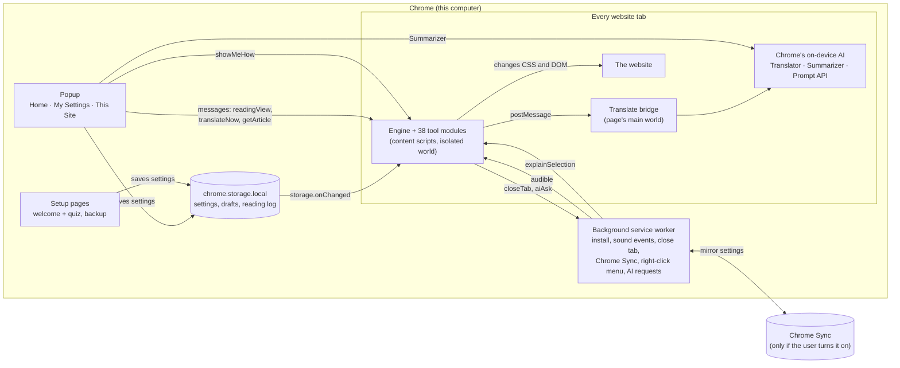
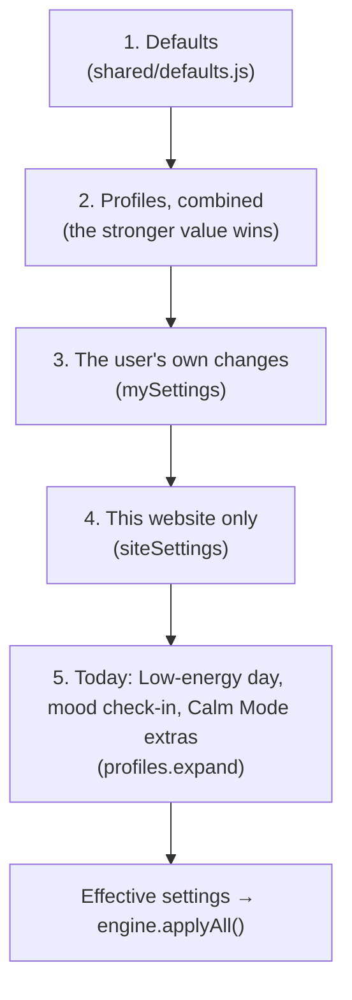

# Ease architecture

Ease is a Chrome extension (Manifest V3). It changes every website to fit the user's needs.
It has **no server, no accounts and no build step**. Everything runs on the user's computer.

About 8,800 lines of plain JavaScript, HTML and CSS. 35 tool modules. 10 languages.

## The big picture



**The main rule:** the popup and setup pages only **save** settings.
The content scripts on each page **apply** them. They never talk to each other directly.
They meet in `chrome.storage`. This keeps every part simple and easy to test.

## Parts

| Part | Files | Job |
|---|---|---|
| Popup | `popup/` | Home (tiles, actions, the helpers, a big Hands-free button, Reset to default and Redo the quiz), My Settings (profiles, then 5 groups: Reading and seeing, Calm and focus, Hands and typing, Safety and AI helpers, Caregivers and backup), This Site. Only saves settings. |
| Setup | `onboarding/` | Welcome, needs, quiz, preview. Also "set up for someone else" and "I have a setup file". |
| Backup | `backup/` | Save settings to a file, load them on another computer. |
| Background | `background.js` | Opens setup on install. Tells pages when a tab plays sound. Closes a scam tab. Mirrors settings to Chrome Sync. Starts and stops the sound limiter. Adds the "Explain simply" right-click menu. Passes AI requests to Chrome's Prompt API. |
| Helper page | `offscreen/` | One hidden page (`helper.html`). It runs the sound limiter (a peak limiter in an AudioWorklet) and answers AI requests when the service worker has no Prompt API. |
| Hands-free panel | `handsfree/` | Chrome side panel. Follows the head with the camera (MediaPipe Face Landmarker in `lib/mediapipe/`, on the device) and hears voice commands. Sends the pointer and the commands to the current tab. `grant.html` asks for the camera once, in a normal tab. |
| Engine | `content/engine.js` | Runs the tool modules. Combines CSS filters. Watches for new content. Gives tools only the changed parts. |
| Tool modules | `content/modules/` | One file per tool. Each has `apply(settings)` and `remove()`. |
| Start-up | `content/main.js` | Loads the right settings for this site and applies them. Re-applies when settings change. |
| Translate bridge | `content/translate-bridge.js` | Runs in the page's own JavaScript world, where Chrome's Translator API lives. |
| Shared | `shared/` | Default settings, profiles, storage, languages, translator setup, PIN lock, time-limit rules, AI helper (`ai.js`). Used by every part. |

## How settings become what the user sees

Each layer can change the one before it. The last one wins.



Why layers: a user can turn on 3 profiles, change one thing by hand, turn something off on one website,
and have a tired day, and Ease can still explain where each setting came from. That is what the
"For me" view shows ("from Low stress", "My own changes", "Only here").

## How a tool module works

```js
Ease.engine.register({
  id: "highlight-links",
  observe: false,                 // true = run again when new content loads
  apply(settings) { /* turn on or update */ },
  remove() { /* undo everything */ }
});
```

- **One broken tool never breaks the page.** The engine runs each tool inside `try/catch` (`safeRun`).
- **CSS first.** Most tools only add one `<style>` tag. CSS is fast and easy to undo.
- **Filters are combined.** Dark mode and grey colours both use `filter`, so the engine joins them into one rule.
- **New content.** A `MutationObserver` waits 300 ms after changes, then runs the `observe` tools.
  `Ease.engine.roots()` gives them only the parts that changed, so they do not scan the whole page again.
- **Boxes on the page live in Shadow DOM.** Website CSS can not break them, and they can not break the website.

## Messages

| From → To | Message | Why |
|---|---|---|
| Popup → page | `readingView` | Open or close Reading View |
| Popup → page | `translateNow` | Translate this page now |
| Popup → page | `getArticle` | Get the article text for Summarize |
| Background → page | `audible` | The tab started or stopped playing sound |
| Page → background | `closeTab` | Scam guard: close this tab |
| Popup → background | `soundStart`, `soundLevel`, `soundStop` | Start, change or stop the sound limiter on a tab |
| Background → offscreen | the same, with `target: "offscreen"` | Do the audio work |
| Offscreen → background | `soundEnded` | The tab closed or Chrome stopped the capture |
| Background → page | `soundLimiter` | The limiter runs on this tab, so Maximum volume steps aside |
| Page → background | `soundState` | A new page asks: is my tab limited? |
| Page → background | `goNewTab` | Time limits: open a new tab instead of this site |
| Page or popup → background | `aiAsk`, `aiStatus`, `aiWarm` | Ask Chrome's on-device AI (Explain simply, Show me how). `aiWarm` loads it early. |
| Page ↔ background ↔ helper page | port `ai` / `ai-helper`, message `aiStream` | Explain simply: the answer arrives while it is written. Closing the port stops the AI. |
| Background → helper page | `aiAsk`, `aiStatus` with `target: "offscreen"` | Used when the service worker has no Prompt API |
| Background → page | `explainSelection` | Right-click "Explain simply" on selected text |
| Popup → page | `showMeHow` | Start "Show me how" with the words the user typed |
| Hands-free panel → page | `hfPointer`, `hfClick`, `hfCommand`, `hfStatus` | Move the big pointer (x, y from 0 to 1), click with a face gesture, run a voice command, show a short message |
| Grant page → panel | `hfGranted` | The camera is allowed now |
| Panel ↔ background | port `hf-panel`, `{ running }` | If the panel closes while Hands-free runs, the background turns Hands-free off |
| Panel → page | `hfGesture` | How long the mouth (or eyebrows) has been held, so the ring fills before the click |
| Page → panel | `hfWriting` | The Write box opened or closed: listen for words (in the user's language) or for commands |
| Panel → page | `hfDictate`, `hfWriteAction` | Words for the Write box (also while they are spoken), or a Write button said by voice |
| Page or panel → background | `hfTabs` (`list`, `switch`, `next`, `previous`, `close`, `open`, `search`) | Hands-free: show tabs, change tab, open a website. Never types or buys. |
| Page ↔ bridge | `tr-req`, `tr-res`, `tr-progress` | Use Chrome's Translator in the page's main world |

## Storage

| Where | Key | Holds |
|---|---|---|
| local | `mySettings` | The user's settings and profiles |
| local | `siteSettings` | Settings for single websites |
| local | `sitesOff` | Websites where Ease is turned off |
| local | `formDrafts` | Form Saver text (24 hours, never passwords or card numbers) |
| local | `readingSpots`, `readingLog` | Resume reading and Reading goals (never synced or backed up) |
| local | `timeUsage` | Time limits: minutes used today per site, and extra minutes given. Resets each day. Never synced or backed up. |
| local | `syncOn` | Chrome Sync on for this computer |
| session | `summary:<url>` | The last summary, until the browser closes |
| session | `soundTabs` | Tabs where the sound limiter runs, and their level |
| sync | `mySettings`, `siteSettings`, `sitesOff` | Only if the user turns on Chrome Sync |

Full list of settings: [settings-format.md](settings-format.md).

## Privacy by design

- No server. Ease makes **no network requests** of its own.
- Translation and summaries use **Chrome's on-device AI**. Page text never leaves the computer.
  (The only exception is a Google Translate link for Punjabi and Tagalog, which the user must click, with a clear note.)
- Health-related choices (profiles) stay in `chrome.storage.local`, unless the user turns on Chrome Sync.
- Backups and caregiver setup files never include form text or reading history.
- Hands-free: the camera picture stays in the side panel. It is never saved or sent. Voice is turned into text
  by Chrome: on the device when Chrome can, otherwise by Google's speech service (the panel says which).
- Hands-free never buys: pay, checkout, add to cart and card fields are blocked (see decision 11).

## Quality

| Check | Tool | Result |
|---|---|---|
| Accessibility of Ease itself | axe-core, 30 screens and states (with the hands-free panel and grant page) | 0 WCAG 2.2 AA problems |
| Speed | Playwright benchmark, heavy page | 95 ms setup with all 35 tools on |
| Behaviour | jsdom and Chromium scripts | every tool tested on and off |

## Why things are built this way

Short decision records (one page each) in [decisions/](decisions/):

1. [No backend and no accounts](decisions/0001-no-backend-no-accounts.md)
2. [Plain JavaScript, no framework, no build step](decisions/0002-plain-javascript.md)
3. [A module engine with apply and remove](decisions/0003-module-engine.md)
4. [Settings in layers](decisions/0004-settings-layers.md)
5. [On-device AI, and a bridge to the page's world](decisions/0005-on-device-ai.md)
6. [Shadow DOM for everything Ease adds to a page](decisions/0006-shadow-dom-overlays.md)
7. [Caregivers without accounts](decisions/0007-caregivers-without-accounts.md)
8. [Tools only scan what changed](decisions/0008-scan-only-changes.md)
9. [A real sound limiter with tab capture](decisions/0009-sound-limiter.md)
10. [AI helpers that guide, and kind time limits](decisions/0010-ai-helpers-and-time-limits.md)
11. [Hands-free: head and voice, and no buying](decisions/0011-hands-free.md)
